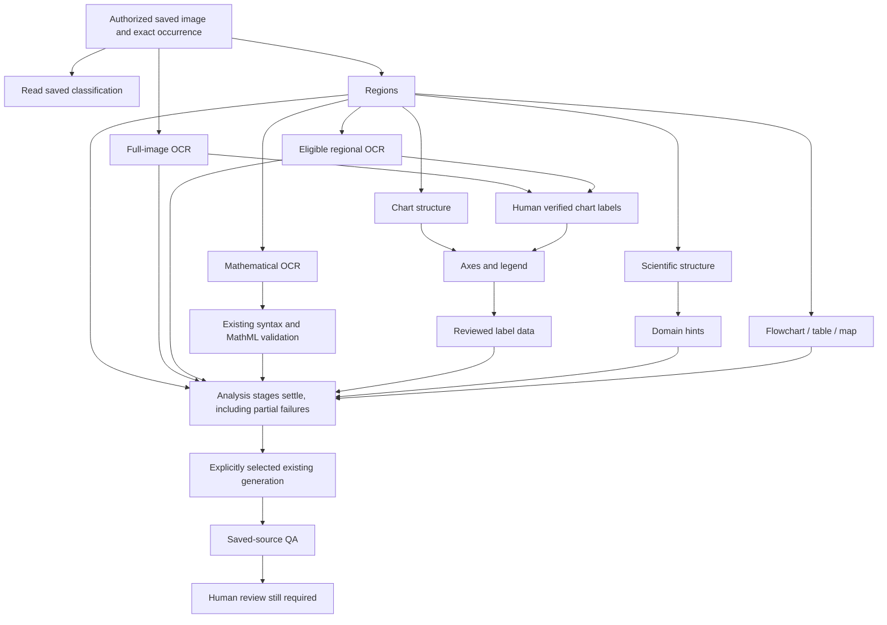

# Task 22 — Advanced processing, existing jobs and credits

Implemented on `feat/phase3-task08-math-ocr`, 2026-10-28. This is a source implementation and local verification report; it does not confirm production deployment.

## Existing services reused

| Workflow | Reuse and resulting behavior |
| --- | --- |
| Single image | Existing upload, Generate settings and editor. “Save source for advanced processing” saves the image without generating a description. The collapsed processing control selects explicit stages and shows actual saved targets and references. Existing ordinary Generate remains available. |
| Current Batch / History | Existing draft, settings JSON, per-image overrides, submitter permissions, batch processor, progress and image review drawer. Opt-in processing owns generation for that image; the ordinary batch generator does not also generate. At most ten pending image runs are scheduled per delivery. |
| Document images | Existing selected eligible image assets and batch submission. Persisted runs retain exact document/occurrence/location metadata. A uniquely authorized occurrence is canonicalized before storing evidence; ambiguous/ineligible sources fail closed. |
| Scanned pages | Existing page OCR jobs/workbench remain distinct. No page number is substituted for an image occurrence or image asset. |
| Queue | Existing `platform_background_jobs` and events. The new handler is `alt_text.accessibility_processing`, with a compact `{pipelineId}` payload. Operational progress uses the existing accessibility evidence table, kind `processing_pipeline`. |
| Analyses | Existing region detector, local OCR, mathematical recognizer and syntax validation, chart/axes/data, scientific structure/domain and illustration services. Child analyses retain their existing jobs, source checks, results and paid receipts. |
| Description / QA | Existing governed generator and Task 21 saved-source QA. Approved descriptions retain the existing generated-candidate behavior. QA does not approve candidates or descriptions. |
| Credits | Existing reservations, provider abstraction, token usage, settlement, releases and ledger. No additional ledger, price formula or charge for local processing. Batch usage includes exact pipeline request identities and persisted child identities. |

## Dependencies and partial results

The graph describes optional selected stages, not a requirement to run everything. Classification is a read of saved classification; automatic classification is already part of explicitly selected generation, not a new standalone provider service. Generation adds classification and QA to the selection. Math recognition adds syntax validation. Regional work is expanded only after a real saved detector result, against that exact analysis ID. Unverified frames stop for review. Each selected region stage is bounded to eight actual matching roots; omitted targets are reported.

Only real hard dependency failures skip their children. Independent OCR, description generation and other eligible paths can continue after an unrelated analysis failure. Fresh raw OCR is never promoted to human-verified chart labels. Missing reviewed labels produce `needs_review`; graph data remains skipped until its dependency exists. A local retry can resume eligible nonbillable work after review without regenerating a completed paid description. Raw recognition, human corrections and quality findings retain their separate stores and meanings.

## Worker behavior and recovery

Each parent delivery performs at most one existing leaf operation, checkpoints before and after it, and returns to the existing queue with bounded deferral when more work remains. It releases its worker slot while a durable child runs. Child jobs have higher existing priority than the parent, avoiding a parent holding the heavy-worker slot while waiting for a child.

Progress checkpoints require the parent tenant, evidence ID, job ID, worker ID, live lease and expected progress revision. Queue claim/count transactions now serialize through an existing queue row for all job types, apply tenant and batch caps, retain document/heavy limits and prefer the least recently served tenant within priority. Heartbeats renew every 15 seconds, cannot revive expired claims and are bounded by the invocation deadline. Stale workers cannot settle another worker's job or decrement its delivery attempt. Timeout/lease loss cannot become successful completion. Exhausted lease recovery reconciles remaining pipeline stages and preserves completed references.

Source bytes are scan-cleared, bounded to 20 MB and fingerprinted. The source and current submitter permission are rechecked before deliveries. Synchronous region detection and generation additionally compare the exact bytes used by the paid call with the run fingerprint. Queued child input hashes are checked before the parent releases its heavy slot; a mismatched child is cancelled. Mathematical workers now recheck active user, record scopes and current document eligibility rather than opening the image with an unconditional all-image scope.

Batch pause/cancel is checked by the parent and existing math/advanced children at source/provider checkpoints. Cancellation is cooperative: completed evidence is retained, queued children receive cancellation and an in-flight provider may finish with its existing usage recorded. Cancellation never promises a refund of work already performed.

## Idempotency and accounting

The parent request is bound to asset, canonical occurrence, actor, source and selected settings. A concurrent active run for the same source is rejected. Node operation IDs are deterministic and fit existing service limits. Restarts reuse child request identities and existing paid receipt handling; they do not choose new paid request IDs automatically.

The region detector and ordinary generator do not have a generic persisted raw-provider receipt. If a parent is interrupted during one of those synchronous paid stages, the stage becomes `needs_reconciliation`. It is deliberately not auto-rebilled or declared saved. A billed-but-unsaved result has the same treatment. Existing advanced children keep their persisted provider receipt and reconciliation behavior.

Credit exhaustion and provider rate limits park the same operation with bounded delays. Existing credit tests cover reservation/settlement, concurrency and ledger-failure recovery. Local OCR, CPU mathematical recognition, syntax, reviewed-label axes/data and QA have no fabricated external-token charge. Billable region/chart/science/domain/illustration/generation selections and their dependencies require explicit confirmation.

The existing batch-credit endpoint now matches exact saved pipeline operation IDs plus source-scoped child request identities, including a child enqueued before a parent checkpoint. It deduplicates reservations before summing actual charges, holds and releases, preserves own-user and tenant filtering and never reserves or settles during a read. Its existing 5,000-row bounds are explicitly reported when reached.

## Progress and UI

Run states distinguish queued/processing, partial failure, awaiting human review, reconciliation, cancellation and ready-for-review. Actual node counts include completed, failed, skipped, review, reconciliation, cancelled and pending. Region counts are unknown until detection, rather than estimated. Every run retains `humanReviewRequired: true` and `documentExport: not_requested`.

The existing batch dashboard has a compact advanced-processing summary. A description can be saved while later QA or analysis is still pending; those counts are shown separately. Per-image drawers reuse the existing evidence editors and history. Single-image processing offers an explicit “Load saved description” action rather than replacing unsaved editor drafts. Ordinary generation does not silently start OCR or region calls.

## Verification

- Full Alt Text suite: **1,242 passed, 0 failed, 3 skipped**, 1,245 total in 115 files (112 passing files, 3 existing skipped files). Existing exploratory `zz-explore.test.ts` excluded. This is 75 additional checks compared with Task 21.
- TypeScript: `tsc --noEmit` passed.
- Final production webpack build and standalone preparation passed.
- New queue integrity tests cover live/stale settlement, heartbeat expiry, timeout, deferral fencing, claim limits and tenant fairness SQL boundaries.
- Planner/worker/store/API tests cover explicit stages, dependencies, bounded 100-region expansion, actual progress, private-source changes, document canonicalization, tenant/owner denial, current actors, local retry, cancellation, interrupted paid calls, credits/rate halts, durable references and strict request bodies.
- **120-image** mocked pipeline restart/duplicate-delivery fixture and **120-image** existing-batch integration fixture passed. The latter verifies ten-image scheduling windows, exact occurrence IDs and per-image Hindi override without a second ordinary generation call.
- Multi-page document selection fixture covers distinct figure assets on pages 1 and 3, excludes an ineligible page-5 figure, retains selected processing modes and never queues page numbers as image IDs. Existing page OCR and source/context tests remain in the broad suite.
- Credit attribution tests cover exact generation/region/child IDs, nonbillable local stages, deduplication, settled/reserved/released/reconciliation accounting and own-user/tenant boundaries. Existing metered provider tests use mocked providers.
- Browser: actual processing components with clearly labelled synthetic source/queue/billing responses. Verified local OCR selection without billable confirmation, queued progress, cancellation, disabled domain capability, math's required paid region dependency/confirmation, partial results and local retry availability. Desktop and 390×844 mobile captures saved outside the repository; mobile document width and scroll width both 375 px, with no horizontal overflow. No live provider or tenant mutation was used for browser verification.

## Practical limits and Task 23 readiness

No live MySQL claim race, authenticated production tenant, paid provider, Hostinger host or native Office application was available. SQL/concurrency checks exercise transaction boundaries and fake-clock workers, not a live database deployment. The UI fixtures are component verification, not a full authenticated end-to-end run. Existing scheduler/worker invocation cadence is still required; a deferred run is not a detached HTTP promise. Conservative one-stage deliveries can add queue latency on large selections.

Actual model accuracy is unchanged: the earlier math recognizer remains opt-in and weak on its recorded real fixtures. This task does not make scientific truth, graph exactness, reading order or accessibility conformance verified. Existing unsupported live DOCX context extraction remains unsupported. No active optional client guideline service is available; existing downstream guideline behavior remains additive and absent by default.

Ready for Task 23's targeted privacy, tenant isolation and AI-safety audit. No new authentication, queue platform, asset store, pricing system or exporter was introduced.
