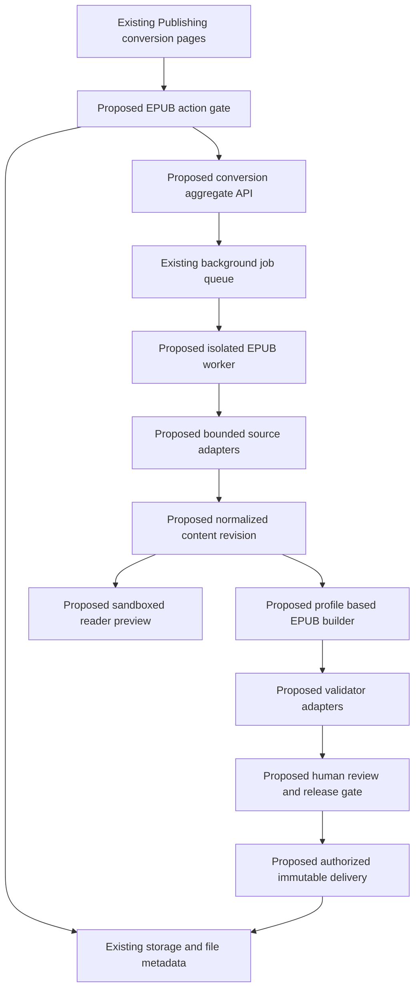

# P1-T09 Reusable frontend backend and engine architecture

Version 1.0 · 29 October 2026 · depends on P1-T01–P1-T08 · documentation only.

Keep the existing Publishing route tree, session system, database pool, blob/file storage and durable execution queue. New code is justified for the absent conversion domain and EPUB transformation behavior. The diagram labels proposed components explicitly; it does not claim an implemented pipeline.



## Boundaries and code ownership

| ID | Existing implementation | Decision/new responsibility | Accountable component |
| --- | --- | --- | --- |
| ARC-01 | `conversion-nav.tsx`; dynamic conversion routes; `pdf-content.tsx`; `components/ui/` | Extend only EPUB route branches; reuse UI tokens and accessible controls | Conversion frontend |
| ARC-02 | `lib/auth.ts`; `lib/api-auth.ts`; `lib/permission-store.ts`; `lib/alt-text/route-gate.ts` | New EPUB domain gate using real grants/project scope and trusted session tenant | Authorization |
| ARC-03 | `lib/storage/index.ts`; `file-metadata.ts`; `keys.ts`; `storage-quota.ts` | Reuse storage, add checked conversion asset refs and release download gate | Shared storage |
| ARC-04 | `lib/background-jobs.ts`; `app/api/jobs/run/route.ts` | Register EPUB handler; use existing enqueue transaction, idempotency, leases and events | Jobs/operations |
| ARC-05 | `lib/alt-text/document-validation.ts`; `docx-context.ts`; `pdf-context.ts`; `ooxml-zip-rewrite.ts` | Extract carefully bounded primitives or wrap them; implement new semantic source adapters | Ingestion |
| ARC-06 | No publication-wide model/builder | New normalized content model, revision serializer and version/layout profile registry | EPUB engine |
| ARC-07 | Shared guideline contracts plus Alt Text version selection | Canonical rule adapter, nullable client profile reference, applicability/conflict checks | Guidelines |
| ARC-08 | `pdf-processing-components.tsx`; Alt Text output validation contract | Reuse findings pattern; new EPUBCheck/Ace adapters and evidence-bound reports | QA |
| ARC-09 | `pdf-preview-components.tsx` is UI chrome only | New inert renderer/reader integration and private resource resolver | Preview/security |
| ARC-10 | `lib/db.ts`; `lib/platform-schema.ts`; Alt Text immutable evidence patterns | One additive shared conversion aggregate, separate content/output revisions | Domain persistence |

Paths in this table are rooted at `components/publishing/conversion/` where only a component filename is shown; `pdf-*` files are under its `pdf/` directory. See the full-path inventory in P1-T02. No proposed engine files are represented as present files.

## Proposed interfaces

These contracts are specification examples, not code committed to lib or generated API routes.

```typescript
type TrustedActor = { userId: number; tenantId: number; actions: readonly string[] }
type GuidelineRef = null | { profileId: string; version: number }
type ConversionRequest = {
  projectId: string; sourceVersionIds: string[]; expectedRevision: number
  profileVersionId: string; guideline: GuidelineRef; idempotencyKey: string
}
type SourceAdapterResult = {
  contentRevisionId: string; sourceSha256: string; modelSchemaVersion: number
  losses: Finding[]; unresolved: Finding[]
}
type Finding = {
  code: string; severity: "info" | "warning" | "error"
  sourceLocator: string | null; outputLocator: string | null; message: string
}
type ValidationReceipt = {
  outputVersionId: string; outputSha256: string; tool: string; toolVersion: string
  profileVersionId: string; status: "passed" | "failed" | "unavailable"; findings: Finding[]
}
```

ARC-11: a single proposed `/api/conversion` family serves shared projects/jobs/files, with service-specific EPUB operations under that family only when needed. It is not created in Phase 1. API boundaries accept identifiers and bounded settings, never raw object keys, remote-fetch URLs, tenant authority or executable guideline code. Validate selected profile versions server-side. Return private no-store responses, typed errors and correlation IDs.

ARC-12: normalized content contains stable nodes (sections, blocks, inline spans, figures, tables, notes, equations, media), language/direction, relationships and source locators. Transformations create immutable revisions. A profile declares supported version/layout/media/validation capabilities; unsupported combinations fail before costly execution.

ARC-13: untrusted archives/XML/HTML/TeX must process within byte/node/resource/time limits, no external entities, no network, no shell escape and no imported script execution. External tools use fixed argument arrays and isolated per-job workspaces; kill/clean up on cancellation/timeout. Preview uses isolated origin/sandbox and explicitly scoped private assets; no same-origin execution of imported content.

ARC-14: job payload references exact source/content/profile/guideline versions. A lease-lost worker cannot publish output. Provider calls require explicit paid-stage authorization through existing AI governance if AI is requested; ordinary conversion is not silently billed as AI. Cancellation records terminal stage state without deleting evidence needed for reconciliation.

## Verification and gaps

Architecture review checked single ownership of identity, bytes, execution and domain state; no second executor or file table is proposed. Required future tests cover adapter determinism, cancellation, lease loss, idempotent retries, tenant isolation, source-to-output loss accounting and exact-hash report binding. External tool licensing, worker isolation capabilities on Hostinger and reader selection are open deployment decisions. Specification acceptance is met; no interfaces/routes were installed. Change log: defined shared/new boundaries and concrete interface contracts.
