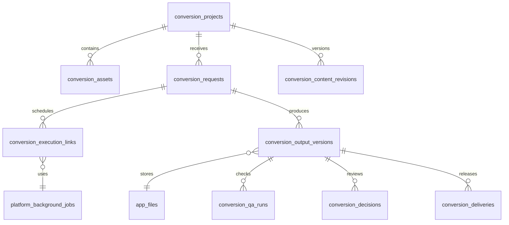

# P1-T10 Projects jobs files revisions and deliverables data model

Version 1.0 · 29 October 2026 · depends on P1-T09 · proposal only; no SQL migration applied or runtime schema changed.

## Existing persistence and reuse decisions

`lib/platform-schema.ts` owns users, sessions, app_files, app_file_blobs and AI credit records. `lib/background-jobs.ts` owns execution jobs/events with unique (job_type, tenant_id, idempotency_key). `lib/alt-text/store.ts` owns alt_text_projects, batches, assets and versions. The latter are image-description domain records, not generic Publishing projects. No shared conversion project aggregate exists in the inspected lib/database files.

DATA-01: reuse users/sessions, app_files/app_file_blobs and background jobs. Do not create EPUB users, EPUB file-byte storage or another execution queue. One shared conversion project aggregate is justified because Alt Text projects have different ownership/lifecycle semantics; do not copy their tables or migrate existing Alt Text rows. A later cross-service project relationship may reference this aggregate without duplicating identity.

## Proposed additive entities

All names below are proposals. All entities have a trusted tenant_id, opaque server-generated ID, actor/timestamps and schema version where JSON is used. Foreign references are tenant-bound. Naming/key types must be finalized against the live MySQL version before implementation.

| ID | Entity and responsibility | Minimum data | Constraints and relationships |
| --- | --- | --- | --- |
| DATA-02 | conversion_projects: shared service project | tenant, project ID, service slug, title, owner, publisher/client reference, lifecycle state, revision, archived_at | Unique (tenant,id); existing users FK; service is allowlisted; optimistic revision; no copied users |
| DATA-03 | conversion_project_members: assignment scopes | tenant, project, user, domain role, granted_by, revoked_at | Unique active project/user/role; tenant-bound user/project; historical assignment audit retained |
| DATA-04 | conversion_assets and asset versions: semantic source/media association | project, role, app_files ID, source hash, ordinal, immutable asset version, rights/security state | Store no blob bytes here; reuse app_files. Unique (tenant,asset,version); rejected/quarantined versions cannot execute |
| DATA-05 | conversion_profile_versions: immutable target configuration | profile ID/version, service, standard/layout IDs, bounded settings JSON, compatibility revision | Unique (tenant,profile,version); standard profile may be explicit platform-owned immutable config; no hidden mutable default in running jobs |
| DATA-06 | conversion_requests: business conversion request | project, exact input/profile/guideline refs, request fingerprint, idempotency key, expected revision, status | Unique (tenant,project,idempotency key); same key/different fingerprint conflicts. Nullable guideline means standard profile; no duplicate execution queue |
| DATA-07 | conversion_execution_links: stage-to-platform-job relationship | conversion request, stage/version, platform job ID, attempt relation | Existing platform_background_jobs runs tasks. Stage uniqueness and transaction enqueue prevent orphaned jobs |
| DATA-08 | conversion_content_revisions: normalized manuscript snapshots | project, parent revision, model schema version, content asset/file ref and hash, source map ref, editor | Append only; content remains in authorized storage; compare-and-swap active revision |
| DATA-09 | conversion_output_versions: immutable artifacts | request, content/profile/guideline versions, app_files ref, SHA-256, media type, status | Unique output ID/hash association; no overwriting a released artifact; byte-affecting changes create a new version |
| DATA-10 | conversion_qa_runs and findings | exact output ID/hash, tool/version, profile, run status, structured findings/file ref, reviewer evidence | Failed/unavailable/not-run differ from passed; no report reused across changed bytes |
| DATA-11 | conversion_decisions and deliveries | revision-bound internal/client decisions, exceptions, release actor, recipient scope, delivery receipt/revocation | Independence rules from P1-T04; release requires current QA/rights/guideline gates; deliveries reference immutable output |
| DATA-12 | conversion_audit_events | tenant/project, actor, action, entity/version, correlation ID, timestamp, bounded field-only detail | Append only; no credentials, full source text, raw policy documents or personal content in logs |

Guideline definitions should be owned by the canonical shared guideline service selected in Phase 4. Until that adapter exists, conversion requests can only reference a validated immutable profile/snapshot through its contract. Do not copy Alt Text profile tables into EPUB tables or assume literal alt-text rules enforce publisher book requirements.

## Relationships and integrity

DATA-13: use composite tenant/parent foreign keys for new domain tables. Existing users/app_files use BIGINT UNSIGNED IDs but do not expose every required composite unique key; plan additive (tenant_id,id) uniqueness indexes before composite FKs, or enforce a documented transactional reference gate until those indexes are installed. Do not reference mismatched signed INT Alt Text keys by guessing. Reject cross-tenant references before insertion and recheck in workers/downloads.

DATA-14: transactionally record the conversion request, immutable fingerprint and existing-queue enqueue. Different payload under the same idempotency key returns conflict. Claim/lease belongs to the platform queue; output publication requires current lease and unchanged active content revision. Stale worker output remains an unattached diagnostic artifact until safely reconciled, never the new approved file.

DATA-15: state invariants include no execution of held inputs, no approval of an obsolete revision, no delivery without exact-hash QA and client-rule decisions, no self-review where independence is required, and no release mutation after delivery. Archive is reversible metadata state; purge is a separate authorized retention workflow. P1-T11 will define the full transition chart; this schema does not claim it implemented.

## Retention privacy and migration review

DATA-16: propose tenant-configurable retention classes for original inputs, working content, generated proofs, released outputs and audit evidence. Durations are unresolved product/contract settings, not invented legal defaults. Persist retention expiry and legal-hold state in the owning domain before enabling purge; `lib/storage/file-metadata.ts` currently projects default retention/null expiry/false hold and does not implement durable holds. Cancelled jobs do not bypass retention.

DATA-17: additions are backward compatible: create new aggregate tables and nonbreaking indexes; leave PDF/XML/HTML/Alt Text data and routes intact. Feature-gate new writers, apply schema in staging, test concurrent transactions/retries, enable limited tenants, and retain migration receipt/backup evidence. Rollback disables new writers/workers and preserves new rows; never drop tables or existing files as an automatic rollback. There is no production migration in this task.

DATA-18: compatibility review checked current key types, queue idempotency, storage ownership and absence of generic project tables. Privacy review checked tenant joins, member scopes, private file references, minimal audit fields, retention holds and immutable decisions. Technical design review found no unresolved contradiction; actual DDL/live-MySQL compatibility, retention durations and external privacy/legal sign-off remain release gates. This is engineering review, not a legal certification.

## Verification and acceptance

Future schema tests must reject foreign tenant references, duplicate keys with mismatched payloads, stale revisions, self-approval and missing QA; recover a failed enqueue without orphaned domain state; retain old output after retry; and preserve held files during purge. Existing tables and migration patterns were inspected, but no database was connected or changed.

The additive model passes the documented engineering compatibility/privacy review with explicit implementation and release dependencies. Specification acceptance is met. Change log: defined shared aggregates, immutable revisions, integrity, idempotency, retention and nondestructive rollout/rollback without duplicating core users/files/jobs.
