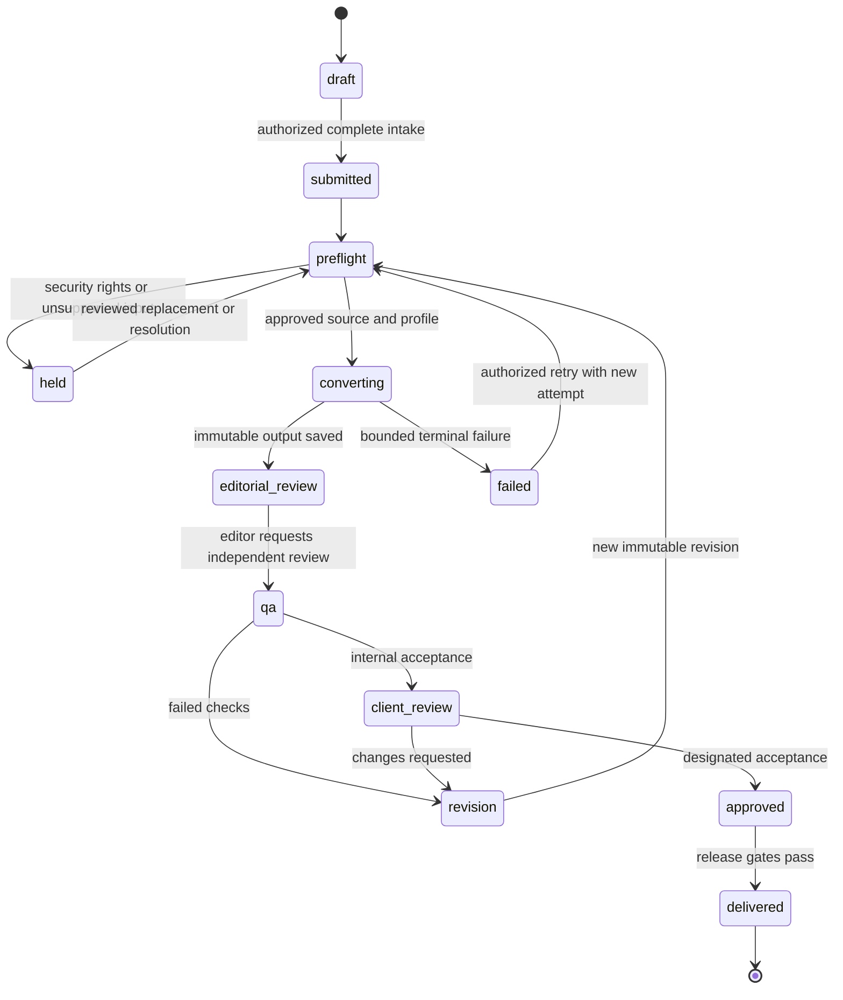

# P1-T11 Workflow states and approval gates

Version 1.0 · documentation only · 29 October 2026. Existing patterns: `lib/background-jobs.ts` for execution leases/events; `lib/alt-text/document-approval-service.ts` for reviewed decisions; `lib/alt-text/document-history-store.ts` for history. Extend the proposed conversion aggregate from P1-T10; do not reuse Alt Text business states as EPUB states.

| ID | Transition or rule | Actor, artifacts and rejection cases |
| --- | --- | --- |
| WF-01 | Draft → submitted | Submitter/project scope; source refs, title, profile and rights acknowledgement; guideline ref nullable. Missing fields reject before any job |
| WF-02 | Submitted → preflight/held | Worker with fixed tenant; security, archive/format, source-version and profile checks. Unsafe/unsupported inputs held with actionable reason |
| WF-03 | Preflight → converting | Operator/lead action and actual engine readiness; immutable fingerprint; transactional enqueue. No available engine means held, never simulated processing |
| WF-04 | Converting → editorial review/failed/cancelled | Current lease only; exact output hash and loss report. Retryable error creates attempt history; cancellation checkpoints preserve diagnostic evidence |
| WF-05 | Editorial review → QA | Content revision frozen; editor resolves losses and uncertainty; assigned independent reviewer; self-review denied |
| WF-06 | QA → revision/client review | Exact-hash validator and manual reports, applicable guideline verdicts, resolved blocking findings. Unavailable validator cannot pass |
| WF-07 | Client review → approved/revision | Designated client/publisher acceptance against exact revision; absent client-review obligation must be explicit in contract, never impersonated |
| WF-08 | Approved → delivered | Release actor checks current revision/hash, QA, rights/security, client rules and recipient scope atomically; stale approvals reject |
| WF-09 | Events and exceptions | Every transition records actor, old/new state, revision, expected revision and reason; legal/security constraints are non-waivable. Authorized waivers retain original failure and expiry |
| WF-10 | SLA/retry accounting | UTC submitted/start/hold/resume/end timestamps; contractual clock separate from worker duration. Paused time only excluded by explicit policy; no invented SLA. Retry keeps original submission timestamp |

Acceptance matrix: unauthenticated submit → 401; foreign tenant → 404; unassigned transition → 403; wrong expected revision → 409; no engine → held; failed QA → delivery denied; changed bytes → approvals invalid; duplicate submit with same fingerprint → same request; duplicate key/different payload → 409; lease-lost publish → denied. These are future executable cases, not passed workflow tests.

Engineering state review found all states reachable with terminal failure/cancel paths and no delivery shortcut. Specification acceptance met; implementation, actual approver assignments and SLA contracts pending. No runtime change. Change log: state chart, transition evidence and invalid-transition matrix added.
